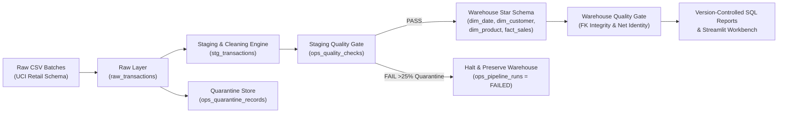

# RetailFlow — Production-Style Retail Data Engineering & BI Platform

RetailFlow is an end-to-end retail data engineering platform that ingests raw transaction feeds, enforces deterministic data-cleaning and quarantine rules, validates data quality at both staging and warehouse boundaries, populates an idempotent Kimball star schema (`dim_date`, `dim_customer`, `dim_product`, `fact_sales`), and exposes operational telemetry and SQL-driven business intelligence through a high-density Streamlit workbench.

---

## 1. Problem Statement & Target Users

Retail operations receive recurring batch transaction files containing mixed merchandise purchases, credit cancellations (`C*` invoices), negative-quantity inventory adjustments, guest checkouts missing customer identifiers, duplicate line transmissions, non-merchandise accounting charges (`POST`, `BANK CHARGES`), and malformed records.

 querying raw CSV exports directly produces distorted revenue figures, inflated customer counts, and silent data corruption on pipeline retries.

**Target Users:**
- **Data Engineers**: Monitor batch ingestion health, data-quality gate assertions, quarantine rejection reasons, and idempotency guarantees alongside Apache Airflow orchestration.
- **BI & Merchandising Analysts**: Query validated star-schema tables for net vs. gross merchandise revenue, cancellation leakage, SKU return rates, customer RFM/LTV segmentation, and regional performance.

---

## 2. Architecture & Data Lineage



### Layered Storage Design
1. **Raw Layer (`raw_transactions`)**: Append-only batch capture with SHA-256 `row_hash` and `source_row_number`. Re-running a `batch_id` atomically replaces that batch's raw slice.
2. **Staging Layer (`stg_transactions`) & Quarantine (`ops_quarantine_records`)**: Parses timestamps, normalizes types, deduplicates identical line items within a batch, routes invalid/non-merchandise rows to quarantine with explicit rejection codes, and computes `gross_amount`, `return_amount`, and `net_amount`.
3. **Analytical Warehouse (`dim_date`, `dim_customer`, `dim_product`, `fact_sales`)**: Star schema loaded only after Staging Quality Gates pass. Uses deterministic surrogate/natural keys so re-running any historical batch is strictly idempotent.
4. **Operations & Observability Layer (`ops_pipeline_runs`, `ops_quality_checks`, `ops_quarantine_records`)**: Tracks execution duration, row counts, check outcomes, and failure stack traces.

---

## 3. Dataset Provenance & Explicit Cleaning Decisions

### Dataset Schema & Provenance
- **Source Schema**: Modeled on the [UCI Machine Learning Repository — Online Retail Dataset](https://archive.ics.uci.edu/dataset/352/online+retail) (Daqing Chen, *School of Engineering, London South Bank University*, licensed under **CC BY 4.0**).
- **Local Reproducibility**: When offline or initializing a fresh environment, `src/retailflow/sample_data.py` generates clearly labelled **synthetic development batches** (`2026_q3_uk_eu_retail.csv`, `2026_q4_oct_retail.csv`) that faithfully reproduce the UCI schema and real-world anomalies. Any real UCI Online Retail CSV file can be ingested directly via CLI or the Streamlit workbench uploader.

### Required CSV Columns (`REQUIRED_CSV_COLUMNS`)
| Column | Type | Description |
| :--- | :--- | :--- |
| `InvoiceNo` | String | 6-digit invoice number; prefix `C` indicates a credit cancellation |
| `StockCode` | String | 5-character product/item code |
| `Description` | String | Merchandise product title |
| `Quantity` | Integer | Quantity per line item (negative for returns/cancellations) |
| `InvoiceDate` | Timestamp | Invoice timestamp (`YYYY-MM-DD HH:MM:SS` or `MM/DD/YYYY HH:MM`) |
| `UnitPrice` | Numeric | Unit price in GBP Sterling |
| `CustomerID` | String | 5-digit customer number (nullable for guest checkouts) |
| `Country` | String | Country of customer residence |

### Explicit Anomaly & Edge-Case Handling Policy
| Edge Case | Pipeline Decision | Rationale |
| :--- | :--- | :--- |
| **Cancellations (`InvoiceNo` starts with `C`)** | Flag `is_cancelled = 1`, `is_return = 1`, `transaction_type = 'CANCELLATION'`. Enforce negative quantity. Set `gross_amount = 0`, `return_amount = ABS(qty) * price`, `net_amount = -return_amount`. | Keeps gross sales uninflated while deducting cancellations from net revenue and tracking cancellation rates. |
| **Negative Quantities without `C` prefix** | Flag `is_return = 1`, `transaction_type = 'RETURN_ADJUSTMENT'`. Record value under `return_amount` and negative `net_amount`. | Separates merchandise returns from positive sales while maintaining accounting identity (`gross - return = net`). |
| **Missing `CustomerID`** | Map to `GUEST_CUSTOMER_ID = 'GUEST_CHECKOUT'` (`is_guest = 1` in `dim_customer`). | Preserves valid store revenue in `fact_sales` while excluding anonymous guest orders from registered customer RFM cohorts. |
| **Exact Duplicate Transactions** | Deduplicate within batch using deterministic SHA-256 key `(InvoiceNo, StockCode, InvoiceTimestamp, UnitPrice, CustomerID, Quantity)` and increment `occurrence_count`. | Prevents double-counting from retry transmissions. |
| **Non-Merchandise Codes (`POST`, `D`, `M`, `BANK CHARGES`, `DOT`, `CRUK`, `AMAZONFEE`)** | Quarantine into `ops_quarantine_records` with `rejection_code = 'NON_MERCHANDISE_CODE'`. | Postage and bank fees distort product-level merchandising metrics. |
| **Invalid Quantities (`0`, non-numeric, or `> 100,000`)** | Quarantine with `ZERO_QUANTITY`, `INVALID_QUANTITY_FORMAT`, or `EXTREME_QUANTITY_OUTLIER`. | Prevents zero-value noise and unverified bulk entry typos. |
| **Invalid Unit Price (`<= 0` or non-numeric)** | Quarantine with `NON_POSITIVE_UNIT_PRICE` or `INVALID_UNIT_PRICE_FORMAT`. | Prevents negative-price corruption in revenue aggregations. |
| **Inconsistent / Unparseable Dates** | Multi-format parser supports ISO and UK/US slashes; unparseable dates are quarantined with `INVALID_INVOICE_DATE`. | Guarantees valid foreign keys into `dim_date`. |

---

## 4. Data-Quality Gates & Failure Isolation

RetailFlow evaluates 8 automated assertions across two quality gates (`src/retailflow/quality.py`):

1. **Staging Quality Gate (`QUALITY_GATE_STAGING`) — Executed before Warehouse Load:**
   - `staging_batch_non_empty`: Asserts `> 0` valid staged rows.
   - `quarantine_rate_within_bounds`: Asserts batch quarantine rate `<= 25.0%`.
   - `zero_null_critical_identifiers`: Asserts `0` nulls across `invoice_no`, `stock_code`, `customer_id`, and `date_key`.
   - `strictly_positive_price_nonzero_qty`: Asserts `0` rows with `unit_price <= 0` or `quantity == 0`.
   - `staging_natural_key_uniqueness`: Asserts `0` duplicate `stg_line_id` keys.
2. **Warehouse Quality Gate (`QUALITY_GATE_WAREHOUSE`) — Executed after Star-Schema Upsert:**
   - `star_schema_referential_integrity`: Asserts `0` orphan foreign keys between `fact_sales` and `dim_product`, `dim_customer`, `dim_date`.
   - `net_revenue_accounting_identity`: Asserts `ABS((gross_amount - return_amount) - net_amount) <= 0.01` for every fact row.
   - `staging_to_fact_row_reconciliation`: Asserts exact row count match between `stg_transactions` and `fact_sales` for the batch.

If any critical check fails in `QUALITY_GATE_STAGING`, promotion to the star schema is aborted immediately, the existing warehouse tables remain untouched, and `ops_pipeline_runs` logs `status = 'FAILED'`, `error_stage`, and `error_message`.

---

## 5. Repository Structure

```text
retailflow/
├── app/
│   └── dashboard.py                     # Streamlit Operations & BI Workbench
├── dags/
│   └── retailflow_etl_dag.py            # Apache Airflow DAG definition & task callables
├── sql/
│   ├── ddl/
│   │   └── 01_schema.sql                # Raw, Staging, Star-Schema, and Ops DDL
│   └── analytics/
│       ├── revenue_trends.sql           # Daily gross/net revenue, returns & AOV
│       ├── best_selling_products.sql    # SKU performance & return rate %
│       ├── customer_value_rfm.sql       # Customer LTV, order counts & RFM segments
│       ├── order_frequency_distribution.sql
│       ├── country_performance.sql      # Geographic revenue & cancellation rates
│       └── cancellation_and_guest_audit.sql
├── src/
│   └── retailflow/
│       ├── config.py                    # Environment & threshold configuration
│       ├── db.py                        # Dual-dialect (PostgreSQL/SQLite) engine & SQL runner
│       ├── sample_data.py               # Deterministic synthetic UCI retail generator
│       ├── ingestion.py                 # Raw CSV schema validation & hash ingestion
│       ├── staging.py                   # Cleaning, deduplication & quarantine routing
│       ├── quality.py                   # Staging & Warehouse data-quality gates
│       ├── warehouse.py                 # Idempotent star-schema dimension & fact loader
│       ├── pipeline.py                  # Transactional orchestrator & audit logger
│       ├── analytics.py                 # KPI & observability query service
│       ├── workbench_server.py          # FastAPI Operations & BI Workbench server
│       └── cli.py                       # Command-line interface
├── tests/
│   └── test_retailflow_pipeline.py      # Automated test suite (schema, DQ, idempotency, DAG, API)
├── docker-compose.yml                   # PostgreSQL 16 + Airflow 2.9 + Workbench stack
├── Dockerfile                           # Container build for workbench/CLI
├── pyproject.toml                       # Package manifest & pytest config
├── requirements.txt                     # Pinned dependencies
└── .env.example                         # Environment template
```

---

## 6. Setup, Execution & Verification Commands

### Option A: Local Python Environment (Zero-Daemon Mode — Immediate Execution)

```powershell
# 1. Initialize warehouse schema, seed two multi-month batches + a quarantined corrupt batch demo
.\.venv\Scripts\python.exe -m retailflow.cli seed-demo --include-failed-run-demo

# 2. Inspect warehouse KPIs and pipeline run history from the CLI
.\.venv\Scripts\python.exe -m retailflow.cli status

# 3. Run any version-controlled SQL analytical report
.\.venv\Scripts\python.exe -m retailflow.cli report --name best_selling_products --limit 10
.\.venv\Scripts\python.exe -m retailflow.cli report --name customer_value_rfm --limit 10
.\.venv\Scripts\python.exe -m retailflow.cli report --name country_performance --limit 10

# 4. Run the automated test suite
.\.venv\Scripts\pytest.exe -v

# 5. Launch the Operations & BI Web Workbench (FastAPI on port 8501 or Streamlit)
.\.venv\Scripts\python.exe -m retailflow.cli serve-workbench --port 8501
```

### Option B: Docker Compose Stack (PostgreSQL 16 + Apache Airflow + Streamlit)

When Docker Desktop / Docker Engine is running:

```bash
cp .env.example .env
docker compose up --build -d
```
- **Apache Airflow Webserver**: `http://localhost:8080` (DAG: `retailflow_daily_warehouse_etl`)
- **Streamlit Operations Workbench**: `http://localhost:8501`
- **PostgreSQL 16 Warehouse**: `localhost:5432` (`db: retailflow`)

---

## 7. Limitations & Next Steps

- **Current Scope**: Designed for batch file ingestion (hundreds of thousands of rows per batch) using SQLAlchemy batch inserts and warehouse-native SQL transformations.
- **Next Steps**:
  - Add SCD Type 2 historical tracking (`valid_from`, `valid_to`, `is_current`) on `dim_customer` segment transitions.
  - Add Great Expectations or dbt Core adapters if scaling beyond single-warehouse SQL transformations.
